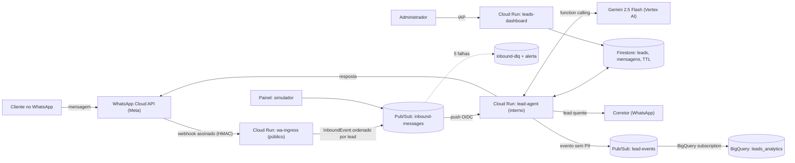

# Caso 4 — Assistente de leads no WhatsApp (arquitetura)

## Princípios

- **Escala a zero:** Cloud Run `min=0`, Pub/Sub, Firestore e BigQuery cobrados por uso; sem Load
  Balancer, Redis ou VMs. `make warm` antes da apresentação e `make cold` depois.
- **Rápido e resiliente:** o webhook só valida e publica (resposta em milissegundos); a IA roda
  de forma assíncrona com retentativas, idempotência por `message_id` e DLQ.
- **IA com guarda-corpos:** o Gemini só extrai dados e conversa; preço, simulação, agenda e nota
  do lead são calculados em código, com ferramentas de lista fechada e argumentos validados.
- **Segurança:** HMAC da Meta, IAP no painel, uma service account por serviço, segredos no
  Secret Manager, deploy sem chaves (WIF) e cadeia de suprimentos verificada no CI.
- **LGPD:** telefone pseudonimizado, mascarado no painel, sem PII em logs/BigQuery, TTL de 90 dias e
  comandos "apagar meus dados" / "parar".

## Nota do lead (determinística)

| Critério | Pontos |
| --- | --- |
| Renda compatível com a parcela (30% da renda) | 30 (15 se ≥ 85%) |
| Prazo de compra (até 3 meses / 3–6 / +6) | 25 / 12 / 5 |
| Visita agendada ao decorado | 20 |
| FGTS ou entrada disponível | 15 |
| Mora ou trabalha na região | 10 |

QUENTE ≥ 70 · MORNO 40–69 · FRIO < 40. Lead quente ou pedido de humano → aviso ao corretor.
